# Textile POS and Billing

**Created by XeonModz** | **Live Demo:** [pos.hrithikuday.in](https://pos.hrithikuday.in/)

A Django-based Point-of-Sale (POS) and inventory management system designed specifically for textile, garment, and fabric retail stores. It features fractional unit billing (meters, yards, rolls, kg, pieces), an administrator dashboard, staff cashier checkout, return management with stock restoral, financial ledgers, and receipt printing.

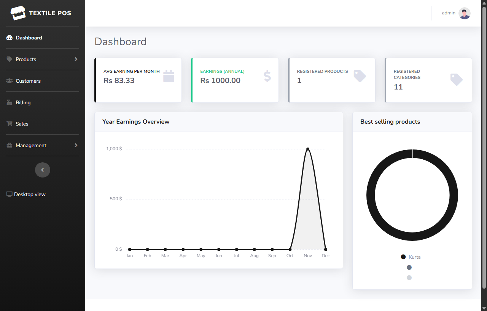

## Screenshots

### 1. Billing Terminal & Receipts
| Create New Sale / Billing | Printable Receipt |
| :---: | :---: |
| 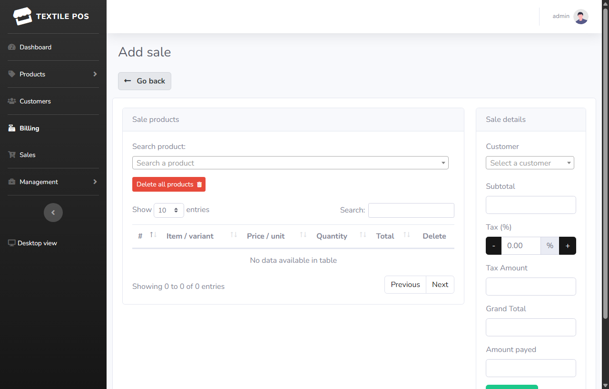 | 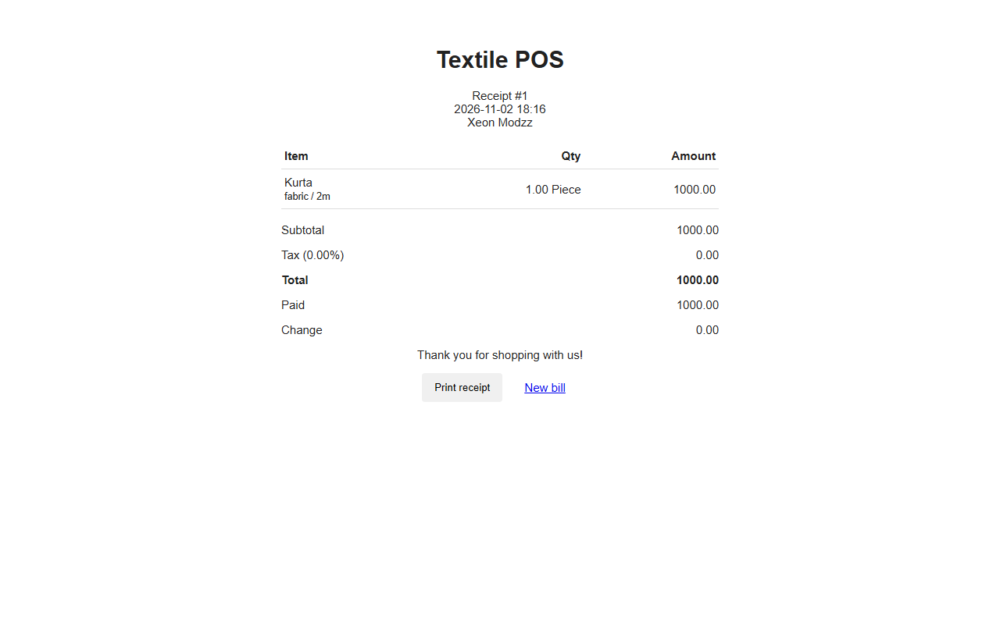 |

| Transaction Details | Mobile Admin UI |
| :---: | :---: |
| 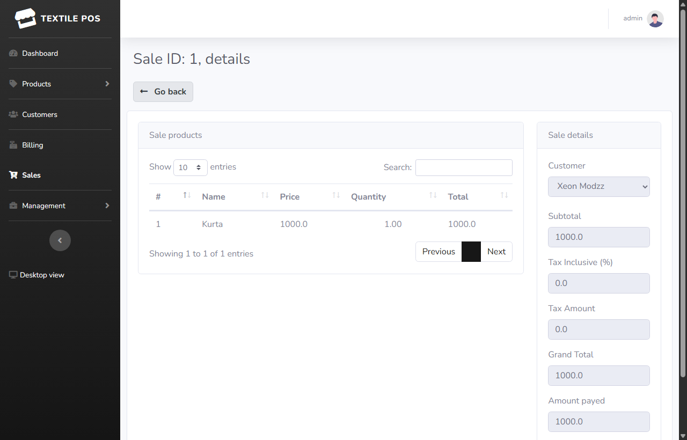 | 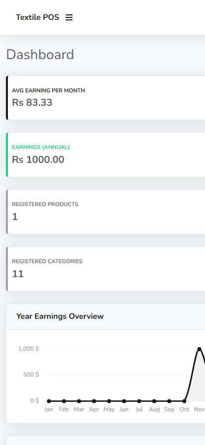 |

### 2. Products & Textile Inventory
| Product Catalog & Stock | Add Product (Variants & Units) |
| :---: | :---: |
| 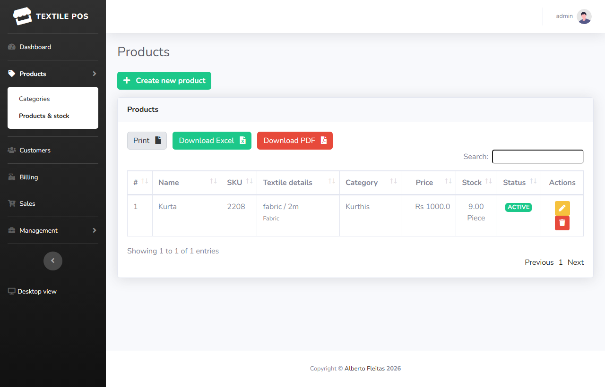 | 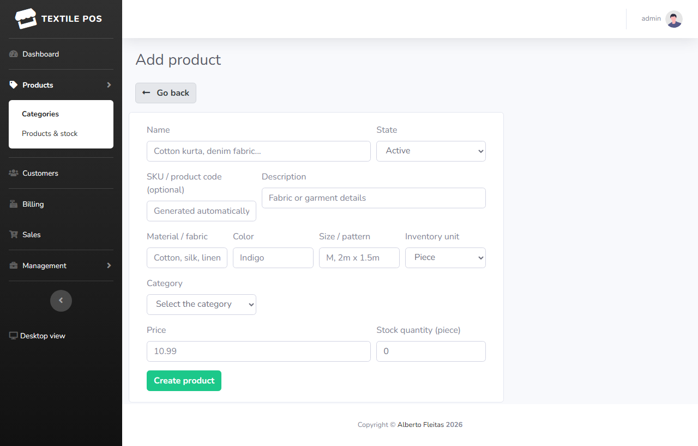 |

### 3. Management, Accounting & Reports
| Cash Ledger | Low-Stock & Sales Reports |
| :---: | :---: |
| 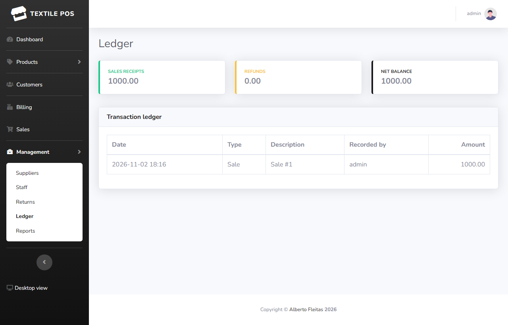 | 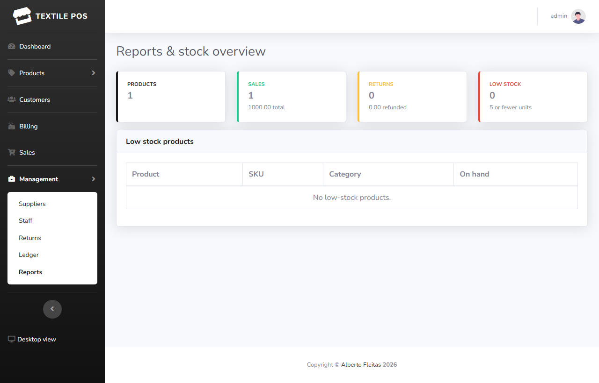 |

| Staff & Cashier Access Control | Sale Returns & Stock Restoral |
| :---: | :---: |
| 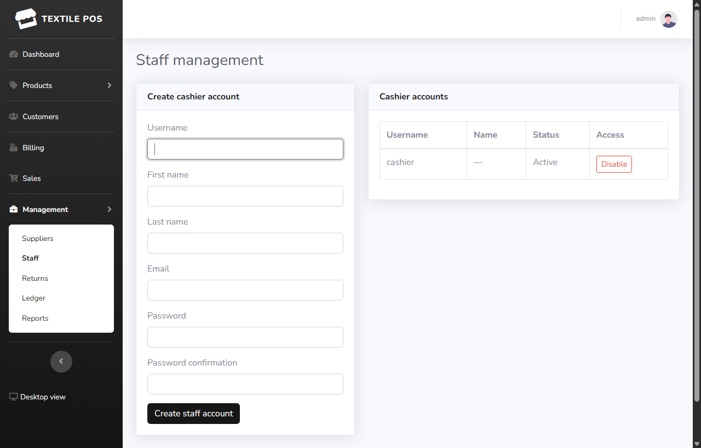 | 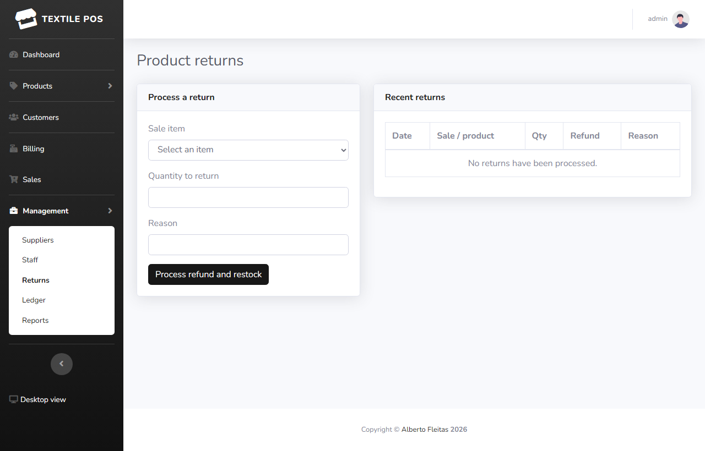 |

---

## Features

- Admin dashboard, product/category CRUD, SKU and stock tracking, and low-stock reports
- New installations are seeded with textile categories for fabrics, sarees, kurtis, tops, dresses, bottom wear, shawls, kidswear, home textiles, and accessories
- Textile product variants: fabric/material, color, size or pattern, and inventory units (pieces, meters, yards, rolls, and kilograms)
- Cashier account creation and access enable/disable controls
- Password reset by email for staff and administrator accounts
- Supplier directory and editing
- Staff checkout with customer selection, per-unit pricing, fractional quantities for fabric sold by length, tax calculation, payment validation, stock deduction, and printable receipts
- Sale returns with unit-aware fractional quantity validation, stock restoration, and refund ledger entries
- Transaction history, cash ledger, and sales/return summaries
- Responsive admin screens and a mobile-admin layout at `/manage/mobile-admin/`
- Admin access is restricted to Django superusers/staff; staff accounts can bill and manage customer records
- Public self-registration is disabled; administrators create cashier accounts

## Technology

- Python and Django
- SQLite
- Django templates, Bootstrap-based responsive UI, and JavaScript

## Run locally

From the repository root:

```powershell
python -m venv .venv
.\.venv\Scripts\Activate.ps1
pip install -r requirements.txt
cd django_pos
python manage.py migrate
python manage.py createsuperuser
python manage.py runserver
```

Open `http://127.0.0.1:8000/`. Sign in with the superuser account. Create cashier accounts from **Staff**. Cashier users sign in at `/accounts/login/` and are taken directly to billing.

For the mobile admin interface, sign in as an administrator and open `http://127.0.0.1:8000/manage/mobile-admin/`. The mobile layout remains active while navigating the admin pages; use **Desktop view** to switch back.

To expose this local app through the current ngrok tunnel, start Django on the tunnel's configured local port:

```powershell
cd django_pos
python manage.py runserver 127.0.0.1:3000
```

The current ngrok hostname is explicitly included in `ALLOWED_HOSTS` and `CSRF_TRUSTED_ORIGINS`. If the ngrok hostname changes, set `DJANGO_ALLOWED_HOSTS` to a comma-separated list of exact hostnames and `DJANGO_CSRF_TRUSTED_ORIGINS` to their full `https://` origins before starting Django. Do not use wildcard hosts.

## Deploy on Render.com

This project is pre-configured for deployment on Render using the included `build.sh` and `render.yaml`:

1. Create a **New PostgreSQL** database on Render (Free plan).
2. Create a **New Web Service** connected to this repository:
   - **Build Command:** `chmod +x build.sh && ./build.sh`
   - **Start Command:** `gunicorn --chdir django_pos django_pos.wsgi:application`
3. In **Environment Variables**, set:
   - `PYTHON_VERSION`: `3.10.12`
   - `DJANGO_DEBUG`: `false`
   - `DJANGO_SECRET_KEY`: *(Generate in Render)*
   - `DATABASE_URL`: *(Internal connection string of your Render PostgreSQL database)*
4. Once deployed, open the Render **Shell** tab and run:
   ```bash
   cd django_pos && python manage.py createsuperuser
   ```

## Notes

- Existing products start with zero inventory; set stock quantities in the product editor before billing them.
- Product and sale quantities support up to two decimal places, so fabric can be sold by partial meters or yards as well as by piece.
- Receipt PDF generation uses WeasyPrint. Its platform dependencies may need to be installed separately on some operating systems; browser-printable receipts are also available.
- Configure `SECRET_KEY`, `DEBUG`, and `ALLOWED_HOSTS` appropriately before deployment. The included SQLite database is intended for local development.
- Local password-reset emails are printed in the Django server console. For deployed email delivery, configure `DJANGO_EMAIL_BACKEND` (typically `django.core.mail.backends.smtp.EmailBackend`), `DJANGO_EMAIL_HOST`, `DJANGO_EMAIL_PORT`, `DJANGO_EMAIL_HOST_USER`, `DJANGO_EMAIL_HOST_PASSWORD`, `DJANGO_EMAIL_USE_TLS` or `DJANGO_EMAIL_USE_SSL`, and `DJANGO_DEFAULT_FROM_EMAIL`.
